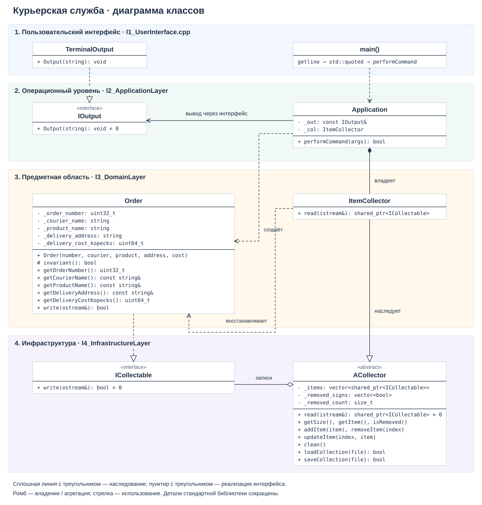
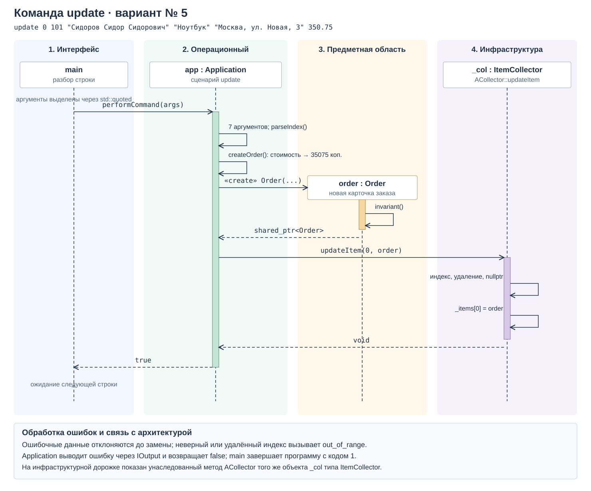

<div align="center">
Министерство науки и высшего образования Российской Федерации<br />
Федеральное государственное бюджетное образовательное учреждение<br />
высшего образования<br />
«Московский государственный технический университет<br />
имени Н.Э. Баумана<br />
(национальный исследовательский университет)»<br />
(МГТУ им. Н.Э. Баумана)
</div>

<hr />

<div align="center">
ФАКУЛЬТЕТ ИНФОРМАТИКА И СИСТЕМЫ УПРАВЛЕНИЯ<br />
КАФЕДРА КОМПЬЮТЕРНЫЕ СИСТЕМЫ И СЕТИ (ИУ6)
</div>

<br />

<div align="center">
ОТЧЁТ<br />
к лабораторной работе № 1<br />
по дисциплине «Современные средства разработки ПО»<br />
«Изоляция предметной области»<br />
Предметная область: вариант № 17 — «Курьерская служба»<br />
Диаграмма последовательности: вариант № 5 — update
</div>

<br />

Преподаватель: Фетисов М. В.

Студенты группы ИУ6-51Б:

- Халин А. Р.;
- Уваров А. В.

<div align="center">Москва, 2026</div>

## Цель работы

Приобрести навыки описания модели предметной области, её изоляции в многоуровневой архитектуре, работы с репозиторием и сценарием непрерывной интеграции.

## Задание

**Предметная область: вариант № 17 — «Курьерская служба».** Карточка «заказ» содержит номер заказа, ФИО курьера, название товара, адрес доставки и стоимость доставки.

**Диаграмма последовательности: вариант № 5 из таблицы 3 — команда `update`.** Диаграмма показывает прохождение команды между объектами четырёх уровней архитектуры.

Основание: М. В. Фетисов, «Методические указания по выполнению лабораторных работ и домашнего задания по дисциплине “Современные средства разработки программного обеспечения”», МГТУ им. Н. Э. Баумана, 2024: раздел 3, таблица 3 (с. 28), приложение В, строка 17 (с. 63).

Реализованы операции добавления, просмотра, изменения и удаления заказов, очистка коллекции, сохранение и загрузка. Программа написана на C++17 с разделением на четыре требуемых модуля. Словарь, ограничения полей и UML-диаграммы приведены ниже.

## Словарь предметной области

| Термин | Определение и представление в программе |
|---|---|
| Курьерская служба | Организация доставки товаров; предметная область приложения. |
| Заказ | Карточка поручения на доставку товара; объект класса `Order`. |
| Номер заказа | Положительное целое обозначение заказа, поле `_order_number`. |
| Курьер | Исполнитель доставки; ФИО хранится в `_courier_name`. |
| Товар | Наименование доставляемого товара, поле `_product_name`. |
| Адрес доставки | Текстовое описание места назначения, поле `_delivery_address`. |
| Стоимость доставки | Сумма в рублях с точностью до копейки; внутри `Order` хранится целым числом копеек в `_delivery_cost_kopecks`. |
| Коллекция | Набор карточек, которым управляет `ItemCollector`, наследующий `ACollector`. |
| Индекс | Позиция карточки в коллекции, начиная с нуля; аргумент `remove` и `update`. |
| Логическое удаление | Установка признака удаления без изменения индексов остальных карточек. |

## Модель и инварианты

Поля `Order` закрыты. Конструктор проверяет инвариант и отклоняет некорректное состояние исключением `std::invalid_argument`. Методы чтения не позволяют изменять поля. Команда `update` создаёт новый корректный заказ и заменяет карточку целиком.

| Поле | Тип | Допустимые значения |
|---|---|---|
| Номер заказа | `std::uint32_t` | От 1 до 4294967295 включительно. |
| ФИО курьера | `std::string` | От 1 до 200 байт. |
| Название товара | `std::string` | От 1 до 200 байт. |
| Адрес доставки | `std::string` | От 1 до 500 байт. |
| Стоимость доставки | `std::uint64_t` в копейках | От 0 до 9999999999 копеек, то есть до 99999999.99 руб. включительно. |

Текстовые поля не могут состоять только из пробелов и содержать управляющие ASCII-символы (коды 0–31 и 127). Для UTF-8 ограничения длины относятся к байтам. Стоимость задаётся десятичным числом рублей с точкой и максимум двумя цифрами после неё: `250`, `250.5`, `250.50`. Использование целых копеек исключает погрешность двоичного представления дробных сумм; бесплатная доставка допустима.

Методические указания задают состав полей, но не их диапазоны. Приведённые ограничения приняты в этой реализации. Номер заказа является полем карточки; уникальность номеров не проверяется. Операции коллекции адресуют карточки по индексу.

Инвариант общей коллекции: длины массивов записей и признаков удаления совпадают, а число удалённых записей не превышает размер коллекции. Допускается до 1000000 позиций, включая удалённые. `clean` очищает записи, признаки удаления и счётчик.

## Многоуровневая архитектура

| Уровень | Файлы и элементы | Ответственность |
|---|---|---|
| 1. Пользовательский интерфейс | `src/l1_UserInterface.cpp`; `main`, `TerminalOutput` | Читает строки, выделяет аргументы через `std::quoted`, передаёт команду приложению и выводит сообщения. |
| 2. Операционный уровень | `include/hw/l2_ApplicationLayer.h`, `src/l2_ApplicationLayer.cpp`; `Application`, `IOutput` | Проверяет команду, преобразует аргументы и стоимость, организует операции с заказами и формирует ответ. |
| 3. Предметная область | `include/hw/l3_DomainLayer.h`, `src/l3_DomainLayer.cpp`; `Order`, `ItemCollector` | Описывает заказ, допустимые состояния и восстановление конкретной карточки из потока. |
| 4. Инфраструктура | `include/hw/l4_InfrastructureLayer.h`, `src/l4_InfrastructureLayer.cpp`; `ICollectable`, `ACollector`, функции чтения и записи | Обеспечивает общую коллекцию, логическое удаление и бинарное хранение. |

Зависимости направлены от верхних уровней к нижним. `Application` владеет `ItemCollector` и использует обратный вызов `IOutput`, реализуемый в UI. `Order` реализует `ICollectable`, а `ItemCollector` наследует общие операции `ACollector`. Инфраструктура не содержит понятий курьера, товара и адреса. Модель не разбирает команды и не обращается к консоли; работа с потоком ограничена контрактом сериализации заготовки.

### Диаграмма классов



Редактируемые исходники: [Mermaid](doc/classes.mmd), [генератор SVG](doc/render_diagrams.py). Диаграмма отражает существенные поля и операции; стандартные типы и вспомогательные функции сокращены для читаемости.

### Диаграмма последовательности update — вариант № 5

Для существующей карточки с индексом 0 выполняется:

```text
update 0 101 "Сидоров Сидор Сидорович" "Ноутбук" "Москва, ул. Новая, 3" 350.75
```



Редактируемый источник: [doc/update.mmd](doc/update.mmd). Инфраструктурная дорожка показывает унаследованный метод `ACollector::updateItem()` того же объекта `_col` типа `ItemCollector`.

1. `main` выделяет аргументы и вызывает `Application::performCommand()`.
2. Приложение проверяет число аргументов, номер заказа и формат стоимости; стоимость преобразуется в 35075 копеек.
3. Создаётся новый `Order`, который проверяет инвариант.
4. Приложение вызывает унаследованный `ACollector::updateItem(index, order)` объекта `_col` типа `ItemCollector`.
5. Коллекция проверяет существование активной позиции и непустой указатель, затем заменяет `_items[index]`.
6. Приложение возвращает `true`, а UI ожидает следующую строку.

При неверном индексе или удалённой позиции `updateItem()` бросает `std::out_of_range`, приложение выводит ошибку и возвращает `false`. Если новые данные некорректны, конструктор `Order` либо разбор аргументов отклоняет их до замены. В обоих случаях исходная карточка сохраняется. Команда `update` изменяет состояние в памяти; запись на диск выполняется командой `save`.

## Командный интерфейс

| Команда | Сокращение | Действие |
|---|---|---|
| `add NUMBER COURIER PRODUCT ADDRESS COST` | `a` | Добавить заказ. |
| `update INDEX NUMBER COURIER PRODUCT ADDRESS COST` | `u` | Заменить активную карточку по индексу. |
| `remove INDEX` | `r` | Пометить карточку как удалённую; повторное удаление допустимо. |
| `view` | `v` | Показать активные карточки и их количество. |
| `clean` | `c` | Полностью очистить коллекцию. |
| `save [FILE]` | `s` | Сохранить активные карточки; по умолчанию в `lab.data`. |
| `load [FILE]` | `l` | Загрузить файл, заменив коллекцию; по умолчанию `lab.data`. |
| `help` | `h` | Показать справку. |

`NUMBER` — номер заказа, `COURIER` — ФИО курьера, `PRODUCT` — товар, `ADDRESS` — адрес доставки, `COST` — стоимость доставки в рублях. `INDEX` — индекс карточки в коллекции, а не номер заказа.

Аргументы разделяются пробельными символами. Текст и имя файла с пробелами заключаются в двойные кавычки. Внутри кавычек обратная косая черта экранирует следующий символ по правилам `std::quoted`: `\"` обозначает кавычку, `\\` — обратную косую черту. Целые числа вводятся без знака и посторонних символов. Пустая строка, строка из пробелов или конец ввода завершают работу успешно. Ошибочная команда завершает программу с кодом 1 и диагностикой. Автоматического сохранения при выходе нет.

Пример сеанса:

```text
add 101 "Иванов Иван Иванович" "Ноутбук" "Москва, ул. Лесная, 1" 250.50
add 102 "Петров Пётр Петрович" "Книга" "Москва, ул. Бауманская, 2" 100
update 0 101 "Сидоров Сидор Сидорович" "Ноутбук" "Москва, ул. Новая, 3" 350.75
view
remove 1
save "orders collection.data"
clean
load "orders collection.data"
view
```

Последний `view` выводит:

```text
[0] Заказ № 101 | курьер: Сидоров Сидор Сидорович | товар: Ноутбук | адрес: Москва, ул. Новая, 3 | доставка: 350.75 руб.
Количество элементов в коллекции: 1
```

Логическое удаление сохраняет индексы остальных карточек до очистки или загрузки. В файл записываются только активные элементы; после загрузки они получают последовательные индексы с нуля.

## Хранение данных

Файл начинается с числа активных карточек (`std::uint64_t`). Каждая карточка содержит последовательно:

1. Номер заказа (`std::uint32_t`).
2. ФИО курьера, название товара и адрес: для каждой строки длина `std::uint16_t` и соответствующее число байтов без завершающего нуля.
3. Стоимость доставки в копейках (`std::uint64_t`).

Числа записываются в бинарном представлении платформы. Формат предназначен для данной реализации приложения и отличается от формата исходной заготовки.

Загрузка проверяет все карточки во временной коллекции и заменяет текущее состояние только после успешного чтения и проверки конца файла. Обрыв файла, недопустимые поля, слишком большое количество записей или лишние байты отклоняются. При неудачной загрузке существующая коллекция сохраняется.

## Сборка и запуск

Требуются компилятор C++17 и `make`. Тесты рассчитаны на Linux и macOS; для подсчёта покрытия нужен `gcov`, совместимый с компилятором. Сборка, тестирование и проверка покрытия не требуют Python и сторонних тестовых библиотек.

```bash
./configure
make
./bin/lab
```

`configure` повторно запускать безопасно; `make` также создаёт каталоги `bin` и `build`. Для запуска примера команд:

```bash
./bin/lab < test/01.test
```

## Проверка программы

```bash
make test
make coverage
# Дополнительно: старые точки запуска тестов поддерживаются.
test/all
```

Все проверки написаны на C++17:

- `test/integration.cpp` запускает приложение отдельным процессом, передаёт команды и проверяет stdout, stderr, код завершения и содержимое файлов. Каждый сценарий работает во временном каталоге; время выполнения процесса ограничено 10 секундами.
- `test/unit.cpp` проверяет модель, коллекцию и прикладной уровень без консольного интерфейса, включая отказ сериализации, неверные состояния потоков и сохранность карточки после ошибочного изменения.
- `test/check_coverage.cpp` запускает `gcov`, объединяет данные о выполненных строках и проверяет порог покрытия. Общие средства запуска процессов и работы с временными файлами находятся в `test/support.h`; запуск процессов использует POSIX API Linux/macOS.

Проверяются добавление, изменение, удаление, повторное удаление, очистка после удаления, сокращённые команды, кавычки и пробелы, границы полей, точность денежных сумм, ошибки аргументов и индексов, бинарный формат, сохранение и загрузка, повреждённые файлы и неизменность коллекции после неудачной загрузки. Shell-скрипты `test/all` и `test/make-result` сохранены как точки запуска и проверки вывода примеров.

`make coverage` сбрасывает счётчики, запускает тесты и требует совокупное покрытие строк `src/` и `include/` не ниже 95 %. Результат сохраняется в `coverage/summary.json`; исходники тестов и системные заголовки в процент не входят. Если отдельный Clang не предоставляет совместимый `gcov`, можно задать `GCOV="llvm-cov gcov" make coverage`.

Результат локальной проверки 8 ноября 2026 года (macOS, Apple Clang 21, C++17): прошли все 18 сценариев C++-тестов, включая 96 отдельных проверок модели, инфраструктуры и прикладного уровня. Покрытие строк — **293 из 303, или 96.70 %**. Вывод примеров сверяется с `test/test-result.sample`.

## Документация

Для Doxygen-документации нужны Doxygen и Graphviz:

```bash
./documentation
```

Начальная страница генерируется в `doc/html/index.html`. Схемы в этом отчёте доступны непосредственно в SVG. Python 3 используется только необязательным инструментом повторной генерации этих SVG; к сборке и тестам он не относится:

```bash
python3 doc/render_diagrams.py
```

## Ответы на контрольные вопросы

1. **Что такое изоляция предметной области?** Отделение модели и её правил от интерфейса, сценариев приложения и технических механизмов хранения.
2. **Как она выполняется?** Код разделяется на уровни с определёнными обязанностями и интерфейсами: понятия и инварианты — в предметном, сценарии — в операционном, ввод и вывод — в UI, общие технические механизмы — в инфраструктуре.
3. **Какие преимущества она даёт?** Уменьшается связанность, модель проще понимать и тестировать, а интерфейс и хранение можно менять с меньшим влиянием на предметные правила.
4. **Назовите слои.** Пользовательский интерфейс, операционный уровень, предметная область, инфраструктурный уровень.
5. **Назначение UI.** Принимать действия пользователя и представлять результаты; здесь — читать команды, выделять аргументы и выводить сообщения.
6. **Назначение операционного уровня.** Организовывать сценарии и взаимодействие объектов, преобразовывать аргументы и вызывать операции модели и коллекции.
7. **Назначение предметного уровня.** Представлять понятия, состояние и ограничения задачи: заказ, его номер, курьера, товар, адрес и стоимость.
8. **Назначение инфраструктуры.** Предоставлять общие технические сервисы: коллекцию, логическое удаление и бинарный ввод-вывод.

## Выводы

Разработано приложение «Курьерская служба» для варианта 17. Модель заказа изолирована от консольного ввода и разбора команд. Реализованы операции с коллекцией и файловое хранение, подготовлены словарь и диаграмма классов. Для варианта 5 таблицы 3 построена диаграмма последовательности `update`, отражающая создание корректного заказа и замену карточки через инфраструктурный слой. Автотесты проверяют основные сценарии, ошибки и сохранность состояния при отказах загрузки и изменения.
