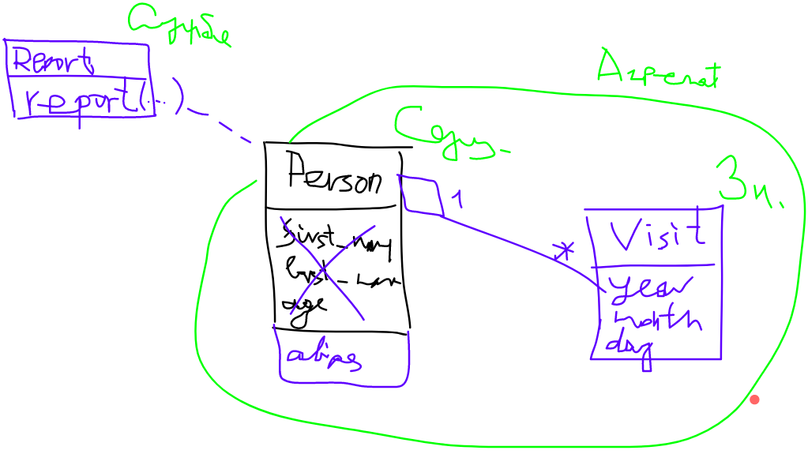

Министерство науки и высшего образования Российской Федерации  
Федеральное государственное бюджетное образовательное учреждение  
высшего образования  
«Московский государственный технический университет  
имени Н.Э. Баумана  
(национальный исследовательский университет)»  
(МГТУ им. Н.Э. Баумана)

ФАКУЛЬТЕТ ИНФОРМАТИКА И СИСТЕМЫ УПРАВЛЕНИЯ  
КАФЕДРА КОМПЬЮТЕРНЫЕ СИСТЕМЫ И СЕТИ (ИУ6)

 

ОТЧЕТ  
к лабораторной работе №2  
по дисциплине "Современные технологии разработки  
программного обеспечения"  
Реализация модели предметной области  
с использованием техники непрерывной интеграции.

 

Преподаватель: Фетисов М.В.

Студент группы ИУ6-59Б Иванов Иван Иванович.

## Описание задания

Задача № 0: "Посещения заведения".

Необходимо реализовать отчёт с перечнем псевдонимов людей и количеством посещений ими кафе в порядке убывания посещений.

## Адрес проекта

Проект хранится в репозитории по адресу: [https://bmstu.codes/lsx/mstd/laboratory-works/lab2](https://bmstu.codes/lsx/mstd/laboratory-works/lab2).

## Документация 

Диаграммы классов создаются автоматически при обновлении ветки `master` в удаленном репозитории GitLab и выкладываются в страницы проекта по адресу: [https://lsx.pages.bmstu.codes/mstd/laboratory-works/lab2/](https://lsx.pages.bmstu.codes/mstd/laboratory-works/lab2/).

Отчёт о покрытии тестами создаётся автоматически при обновлении ветки `master` в удаленном репозитории GitLab и выкладываются в страницы проекта по адресу: [https://lsx.pages.bmstu.codes/mstd/laboratory-works/lab2/coverage](https://lsx.pages.bmstu.codes/mstd/laboratory-works/lab2/coverage).

## Модель

## Выводы

???
